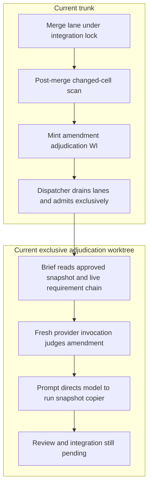

# Work types, approval snapshots and adjudicator continuity

This audit supplements the [target flow](README.md#3-the-target-loop) and
[control repair](CONTROL-RETRY.md#owner-clarification-and-revised-resolution).
Source baseline: `4c26e432`. It records the owner's clarification and proposed
repair; the diagrams do not claim that the runtime already implements it.

## Meaning and approval

The earlier “stale approval evidence” framing was too broad. A changed byte or
requirement attribute triggers mechanical drift detection and a semantic
comparison with the last approved snapshot. It does not establish changed
meaning. If the adjudicator confirms that meaning is unchanged and accepts
the wording, existing implementation judgments remain valid and the mechanical
approval step updates the snapshot. Do not add another implementation approval
requirement merely because that text or its hash changed.

Implementation WIs do not amend their governing SN/SR/LLR prose. A needed
change returns as a handback; a separate exclusive spine WI authors it. The
exclusive window prevents implementation from racing a requirement change.
Judging a handback from ordinary work is still an exclusive adjudication turn;
it does not entitle the ordinary worker to share the adjudicator conversation.

This ownership boundary is not new. Owner ruling **2026-09-01** already states
it, with the same concurrency reasoning, and `lane_approval_refusal` carries the
argument verbatim: two lanes touching the spine conflict at merge and the
snapshot must not move across a workstream, whereas a serial trunk-side act
cannot conflict. The ruling assumed the act was trunk-side; the adjudication-lane
exception landed the same day with the first-approval arm (WI-572) and made it a
claimed worktree, which is what removed the guarantee the ruling rested on. The
repair closes an exception to a standing rule; it establishes no new one.

The snapshot always represents the last approved state. Proposed wording may
be on trunk while awaiting judgment, with the previous snapshot still intact
and drift still visible. Approval and its mechanically produced snapshot must
be published together before the window releases dependent work. Rejection or
a request for revision leaves that baseline intact. A whole-registry copier
must not absorb pending, unapproved cells outside the accepted change.

Identifying which proposal was approved is still necessary to copy the right
content. That bookkeeping is not a second semantic judgment. Likewise, the
existing review of an implementation candidate's tree is a different question
from whether requirement prose preserves its meaning.

## What the runtime does today



The final two nodes expose the ownership defect: the copy can precede accepted
approval, and the adjudicator runs in a worktree even though worker guidance
describes approval as a trunk act. The stopped retry is evidence of this path;
its proposed snapshots have not been integrated into primary.

| Boundary | Read-only finding and source |
|---|---|
| Admission | `dispatch._kind_action` and `_admission` admit ordinary work in parallel, spine batches exclusively, and adjudication exclusively. `_branch_exclusive` also reads claimed safety classes when resuming parked work. These are scheduler guarantees for classified WIs, not proof that every actual edit obeys its class. |
| Location | `lane.spawn_worker` launches the claimed worktree; `agent_loop._resolve_root` makes that worktree the effective root. Exclusive does not mean trunk-resident. |
| Detection | `integrate.integrate_one` calls `intake.intake_after_merge` while holding the integration slot. `_routed_amendments` uses `acceptance_record.staged_spine_amendments` over the before/after merge trees; the amendment brief separately supplies the last-approved snapshot and live chain. The trigger scan itself is not a semantic comparison. |
| Authoring scope | `worker.template.md` permits authoring Drafted rows and amending cell text in its generic worker rules. `acceptance_record.lane_approval_refusal` prohibits approval acts but expressly permits amendments. This does not enforce the owner's implementation-versus-spine separation. |
| Snapshot write (direction) | The amendment and first-approval briefs direct the model to invoke the copier; `adjudicate_brief._aftermath` reinforces this. Move the write to the trunk approval boundary and remove that worker permission. |
| Snapshot write (permission) | Removing that direction is NOT sufficient: the merge slot deliberately permits the act for this actor. `integrate._approval_act_refusal` calls `_adjudication_lane`, true when every claimed spec on the branch declares `safety_class = "adjudication"`, and hands that flag to `acceptance_record.merge_approval_refusal`. The flag selects `adjudication_approval_refusal`, which BOUNDS the flips by the `Adjudicates` cell and lets the snapshot cover the registries those flips changed; only the `False` arm, `lane_approval_refusal`, prohibits a `SNAPSHOT_DIR` write outright. So an adjudication worktree is mechanically authorized to write the approved snapshot today, and the WI-605 lane did. Close the exception, not only the instruction. |

These mechanisms are reusable. The correction is to their ownership and
ordering, not a reason to replace mechanical drift detection or discard
valid implementation work. The existing exclusivity machinery needs an
end-to-end check that the spine window stays held until its judgment and
approval effects settle, including across coordinator restarts.

## Retained adjudicator context

**Cross-WI retention has not landed.** `adjudicator_session.py` and the
`[adjudicator]` configuration table are absent from the current runtime.
`agent_loop.family_context_telemetry` reports provider session metadata but
does not resume a conversation. Restoration is queued in
[WI-551](../work/queued/WI-551-re-land-the-adjudicator-sessio.md), followed by
[WI-541's on-box verification](../work/queued/WI-541-verify-retention-layer.md).
Consequently the current control runs did not deliver the intended continuity,
and this audit found no active retained conversation for parallel WIs to race.

The [preserved patch](../work/handback/wi-540-adjudicator-retention-layer.patch)
needs correction before restoration, based on a static read of its source
diffs, not a claim that it was enabled or exercised here:

- `adjudicator_session.store_dir(root)` and `adjudicator_home_root(root)` use
  the caller's root. Launch and bookkeeping receive the WI worktree root.
  A later WI in a different worktree therefore misses the prior record by
  default. The CLI-home override alone does not move the session-record store.
- The dispatcher's optional `_keepwarm_tick` reads the primary root's store
  and can run while its lane subprocess is active. Merely centralizing the
  store would expose overlapping resume calls: the ping has no exclusion for
  a session already in use. Both calls must pass through the same serial
  owner, including their transcript and bookkeeping updates. An atomic JSON
  replacement does not serialize provider conversation use.
- Retention is selected by adjudication brief class and provider route;
  ordinary worker reviews do not acquire it through that selection. Preserve
  that role separation and per-route identity when moving session ownership
  to trunk. A retained adjudicator must not become its own independent reviewer.
- WI-551 currently combines runtime restoration with spine amendments and is
  classified ordinary. Reconcile that assignment into the required exclusive
  spine work and subsequent implementation before admitting it; “re-land the
  patch” is not sufficient under the clarified work-type rule.

The intended context flow is:

```mermaid
sequenceDiagram
    participant T as Trunk coordinator: sole session owner
    participant A as Retained adjudicator conversation per route
    participant W as Separate worktree
    T->>A: Exclusive judgment for WI A using trunk evidence
    A-->>T: Decision or handback disposition
    T->>W: Dispatch scoped follow-up with its own worker context
    W-->>T: Return outcome and evidence through integration
    T->>A: Resume same conversation for WI B or returned chain
    A-->>T: Judgment
    Note over T,A: One invocation at a time; optional keep-warm uses the same owner
    Note over T,W: Spine authoring is exclusive; workers never write approved snapshots
```

Verify this with two distinct WI worktrees and the same eligible route: the
second adjudication resumes the first conversation, while ordinary reviewers
remain separate. Exercise an active judgment plus a due keep-warm tick, a
restart, and the existing reset policy. Keep-warm must not resume an in-use
session, and reset must not be mistaken for withdrawal of recorded approvals.
This is a retention acceptance check, not a new requirement staleness gate.

The repair plan remains paused. This documentation neither restores the patch
nor launches the coordinator, and it approves no disputed requirement cells.
