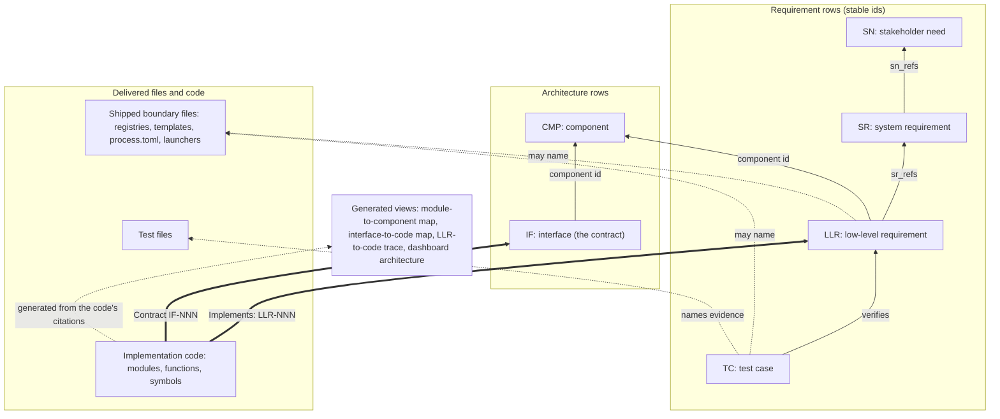

# Spine pointer rules

What each spine artifact may point to, and what it may never name, under the
owner's rulings of 2026-10-11 (the review-churn plan's
[Owner rulings](README.md), items 5 and 10). Every authored pointer runs up
or sideways by stable id. Code carries its own links to the spine, and every
code-facing map is generated from them, so moving or renaming code never
reopens a requirement row.

Solid arrows are id pointers; dotted arrows from LLR and TC name a file;
thick arrows are tags in the code; the arrow into the generated views marks
derived content, never authored.

| Artifact | Points to (by id) | May name files | Never names |
|---|---|---|---|
| SN | stakeholders, assumptions | none | any file; any code |
| SR | SN (`sn_refs`); assumptions | none, rationale included (artifact-class voice: "the delivered registry") | any file; any code |
| LLR | SR (`sr_refs`); its component (`component`) | shipped boundary files: registries, templates, `process.toml`, launchers | code files, functions, symbols (the `module` and `code_symbol` cells are removed) |
| TC | what it verifies (LLR, SR) | test files, modules under test, shipped boundary files | nothing further |
| CMP | none required (architecture block) | none | any file; code (its module list is generated) |
| IF | its component; the assumptions an external crossing relies on | none: artifact-class wording (whether an external crossing may label a shipped file is an open owner question) | any file; code modules (owner, consumers and requestors become generated) |
| Code | up: `Implements: LLR-NNN`, `Contract IF-NNN` | n/a | nothing; it is the leaf every other map is computed from |
| Generated views | computed from the code's tags and the id pointers | anything (derived) | never hand-edited |

The boundary-file set is an explicit `boundary` class on each entry of the
one shipped-file inventory, matched on the destination path (so launchers
shipped from `scripts/run.template.*` count as boundary files). The commit-time
check refuses code tokens in SN, SR, LLR, IF and CMP rows, and boundary-file
names in SN, SR, IF and CMP rows. Every shipped module must carry at least one
`Implements:` tag naming a live LLR, which keeps "why does this file exist"
answerable.
