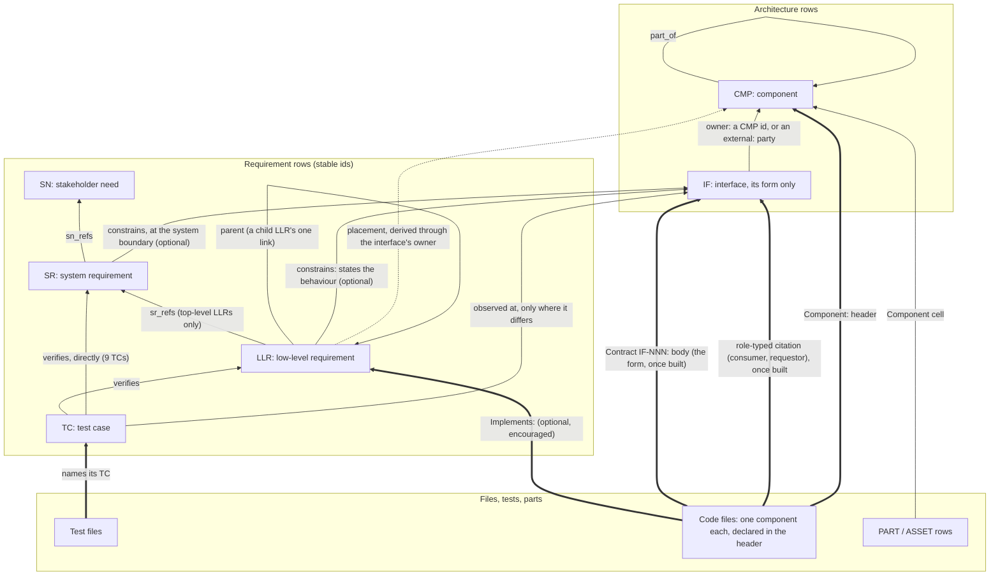

# Spine pointer rules

What each spine artifact points to, what is derived, and what it may never
name. The ruled base is the owner's rulings of 2026-10-11 (the review-churn
plan's [Owner rulings](README.md), items 5 and 10). On top of it sits item 11's
variant F as the owner answered it on 2026-10-13 (plan revision 20): F-calls 1,
2, 8 and 9, decision 1 (an interface's owner is a component id or an
`external:` party) and decision 2 (an interface states its form; an LLR or SR
states its behaviour). Revision 35 rules F as a whole, with every F-call: among
them an authored parent link between LLRs (F-call 5), consumers and requestors
handed over from the IF row to code like the form, and F-call 4 answered by the
owner's keep-or-mint rule (plan item 16, revision 30). The same content, with diagrams, is the
published "Spine Pointer Rules" page.

This file shows the target. Today the registries still have the old shape:
every LLR names its component, interface owners are file paths, and no code
file declares a component.

## The model under variant F

Solid arrows are authored id cells; thick arrows are tags or bodies in files,
pointing up; the dotted arrow is derived, never authored. LLR and TC rows may
still name shipped boundary files (registries, templates, `process.toml`,
launchers); SN and SR rows name no file.

## Where the contract lives

The contract is the interface's form, and it exists in one place at a time.

| | Before the build | After the build |
|---|---|---|
| Home | the IF row's `data` cell: the whole form, as many lines as it needs | the opening of the code's `Contract IF-NNN:` body, the same text, in the file whose header names the owner |
| Judged | at the sitting of the row it serves | unchanged: the cell is generated from the body's form, compared exactly |
| Approval | copied into the approval snapshot | a change to the form shows as drift on the approved row |
| Hand-over | — | checked at the commit: a body's introduction must match the cell; its removal must move or retire the contract |

## Form on the interface, behaviour in the LLR

An interface is testable, but its row states only its form. The expectation
it fulfils is an LLR, or an SR at the system boundary, and that LLR states the
full dimensional scope of the behaviour: the LLR or SR defines the interface's
behaviour with respect to its form. Form is what both sides must agree on to
connect at all; behaviour is what must be true of what flows through. Every
interface is pointed at by at least one LLR or SR through a `constrains` cell
(an SR has one too, for the system boundary), and reaches at least one
executable test that way. An LLR need not name an interface. A shared crossing
is navigation, not a pointer: 35 SRs share crossing B-05.

| Interface | Form, on the interface row | Behaviour, in the LLR |
|---|---|---|
| Power | DC, 2-pin JST-XH, pin 1 positive | 5 V ± 0.25 V up to 2 A |
| NEMA 17 mount | 4 × M3 on a 31 mm square, 22 mm pilot (four screws, one interface) | holds the motor without slipping under its rated torque |
| Exit code | an integer in {0, 1, 2} | which code is returned, and when |
| Parcel location | one of {MAILBOX, SORTING FACILITY, TRUCK, UNKNOWN} | which scan event moves it to which value |
| A function call across components | request: a TC id; answer: one of {verified, red, unknown} (typed, no symbol names) | which answer for which TC state |

## The rules, artifact by artifact

| Artifact | Points to | May name files | Never names | Status |
|---|---|---|---|---|
| SN | stakeholders, assumptions | none | any file; any code | ruled |
| SR | SN (`sn_refs`); assumptions; the boundary crossings it serves (`boundary_refs`); the IF it constrains at the system boundary, if any (an optional traced cell) | none, rationale included | any file; any code | ruled; the `constrains` cell answered in revision 20 |
| LLR | SR (`sr_refs`), on a top-level LLR only; a child LLR names its one parent LLR instead, and its SR is derived up the chain (acyclic). The IF it constrains, if it has one (an optional traced cell). That LLR states the behaviour across the IF and its full dimensional scope, in its dimensions cell, the one home of that input space | shipped boundary files | code files, functions, symbols; its component (the cell retires; placement is derived) | ruled (revision 35); ruling 5's "LLRs keep naming their component" overruled |
| TC | what it verifies: LLRs, or an SR directly; the IF it observes at, only where that differs from its LLRs' (per TC and LLR pair) | shipped boundary files | test files, modules, symbols (its evidence column is generated from test-file tags; CI, inspection and review records stay authored) | ruled (revision 35); the repeat check runs in the strict lints |
| IF | its owner, a component id or an `external:` party (authored, permanently); its consumers and requestors, authored component ids until code cites the IF, then generated (one home at a time); the assumptions bridging an external crossing. Its form only; at least one LLR or SR points at it | none | any file; code (the owner's path leaves the row); any behaviour | ruled: F-call 1 (i), decision 2, roles (revision 35) |
| CMP | its parent (`part_of`, already in the schema) | none | any file; any code | ruled (revision 35) |
| Code file | up: `Component: CMP-NNN` in its header; the `Contract IF-NNN:` body of each IF it owns, opening with the form; a role-typed citation of each IF it consumes or requests; `Implements: LLR-NNN` where useful | n/a | nothing; the leaf every map is computed from | answered: F-calls 1, 2, 9 |
| Test file | up: a tag naming the TC it verifies | n/a | nothing | ruled |
| PART / ASSET | its component (the `Component` cell already in the schema) | its own source location | code | answered: F point 1 |
| Generated views | computed from the cells and tags above | anything (derived) | never hand-edited | ruled |

A non-code shipped file declares its component in the same `#` header that
holds its `Contracts:` marker; a file type with no comment syntax declares it
on its `boundary` entry in the one shipped-file inventory, matched on the
destination path (so launchers shipped from `scripts/run.template.*` count as
boundary files). The commit-time check refuses code tokens in SN, SR, LLR, IF
and CMP rows, and boundary-file names in SN, SR, IF and CMP rows. Links back to
the spine are encouraged, never mandated (the owner withdrew item 5's
per-module floor in revision 15); the coverage dial, shipped at 0, measures
them (PROCESS.md §3).

## Derived, never authored

- **An LLR's placement:** the owner component of the IF it constrains, or of
  the IF its TC observes at. One with neither shows as unplaced and is counted,
  not refused; one observed at several IFs is placed at each.
- **An IF's position in the views:** the lowest component enclosing all its
  endpoints. Placement on the diagram only; an LLR's scope comes from the owner.
- **Each component's boundary set, each file's ancestry, and depth**, from
  `part_of` and the file headers. Depth sets item 12's critique cadence.
- **Blast radius:** from a changed IF, the LLRs that constrain it or are
  observed at it, then the TCs verifying those LLRs. Potential impact, not
  proof of complete coverage.
- **The SR side:** an SR reaches IFs through its boundary crossings and the
  assumptions that bridge them.
- **An IF's test coverage:** every IF reaches at least one executable test
  through the LLR or SR that constrains it, or a TC whose `verifies` names it; no TC
  has to cite the IF directly. OI-43's direct check stays until this link is
  populated.
- **A child LLR's SR:** up its parent chain to the top-level LLR's `sr_refs`.
  The dashboard's spine view shows the requirement tree as the component view
  shows nesting.
- **An IF's consumers and requestors, once code cites it,** from the role-typed
  citations and each citing file's `Component:` header.
- **A work item's component context** (confirmed, revision 35): its SRs and their
  LLRs lead, through the placement relation (a `constrains` cell, or the
  interface a verifying TC names), to interfaces and their owner components,
  which the build brief renders for the builder; an unplaced requirement is
  listed as unplaced. No `if_refs` cell.
- **The IF's `data` cell after the build,** and the TC evidence column, from
  the bodies and tags in files.

## What changes from today

- **The LLR component cell retires** (302 rows); placement is derived.
- **The LLR `module` and `code_symbol` cells are removed** (ruling 5).
- **LLRs gain an optional parent link** (revision 35). A child LLR names one
  parent and carries no `sr_refs`. Every LLR today is top-level, so no row
  migrates until a child is written; PROCESS.md §4's "TERMINAL" and "the tier
  does not recurse" text changes, with the orphan and coverage rules counting
  the tree.
- **The IF owner becomes a component id or an `external:` party**, in place
  of a file path. The existing optional `component` cell (150 of 243 rows)
  becomes that owner; the 35 to 39 cells that name where the IF sits rather
  than who produces it are migrated (decision 1).
- **Code files gain a `Component:` header.** None carries one today.
- **Contract bodies shrink to their form.** The behavioural prose in today's
  204 bodies either already exists in an LLR, and is deleted, or becomes LLR
  text. The 160-character limit retires for form cells.
- **OI-43's direct IF → TC rule is replaced** by coverage through the
  `constrains` link, once that link is populated; about 197 IFs need one. The
  147-row allowlist measures a different relation, so the migration list is
  recomputed.
- **The 115 `call` rows are classified.** One inside a component is optional
  and retires on its original rationale; one crossing a boundary gets a
  symbol-free typed form.
- **External-owned IFs keep their far-side body** (IF-032's lives in
  `check_privacy.py`), checked against a local endpoint, and an LLR or SR
  constrains each of the four.
- **One body per IF:** the stray-declaration rule becomes uniqueness over
  shipped scripts, configuration files and registry headers, with the body's file header naming the
  owner component. A hand-edited boundary file is owned by the component its
  own header declares.
- **The hand-over** is new build work: one effective-contract reader and a
  commit check on each transition.
- **An LLR that constrains an IF gains a dimensions cell** (the `gen_cases`
  grammar of the SR `permutations` cell, which stays for boundary dimensions
  only): a schema change adopters inherit.
- **No IF lists the requirements it carries.** The direction is requirement →
  IF, so OI-67's removal and the `realizes` rejection stand.
- **Stubs are not minted for every file.** The builder creates files as needed
  and must not duplicate an existing one, exactly or in intent.

## Ruled in revision 35

Every call this file once listed as open is ruled (the plan's revision 35
rulings): F-call 3 per pair, its repeat check in `trace.py --strict`; F-call 5
with an authored parent-LLR link; F-calls 6 and 7; consumers and requestors
handed over like the form; the component context in the build brief.
"Module" is no longer a spine term: the units are component, interface and
file.

Decisions 3 (who admits a dependency; the human-or-delegate is one role, apart
from an autonomous run) and 4 (the plan comes after the claim) are process
questions in items 13 and 9, not pointer rules.
