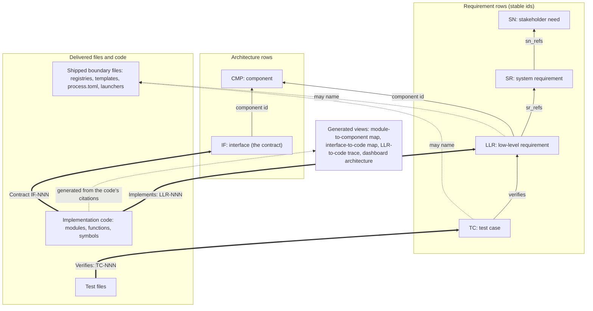
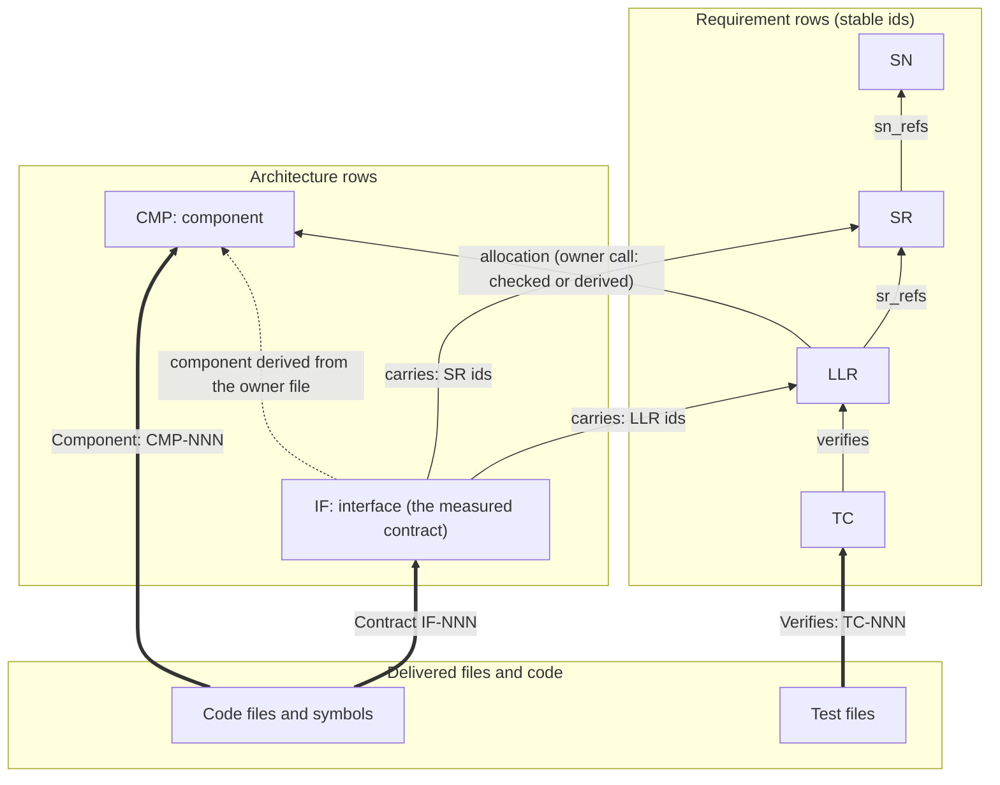

# Spine pointer rules

What each spine artifact may point to, and what it may never name, under the
owner's rulings of 2026-10-11 (the review-churn plan's
[Owner rulings](README.md), items 5 and 10). Every authored pointer runs up
or sideways by stable id. Code carries its own links to the spine, and every
code-facing map is generated from them, so moving or renaming code never
reopens a requirement row.

Solid arrows are id pointers; dotted arrows from LLR and TC name a file;
thick arrows are tags in the code and the tests; the arrow into the generated views marks
derived content, never authored.

| Artifact | Points to (by id) | May name files | Never names |
|---|---|---|---|
| SN | stakeholders, assumptions | none | any file; any code |
| SR | SN (`sn_refs`); assumptions | none, rationale included (artifact-class voice: "the delivered registry") | any file; any code |
| LLR | SR (`sr_refs`); its component (`component`) | shipped boundary files: registries, templates, `process.toml`, launchers | code files, functions, symbols (the `module` and `code_symbol` cells are removed) |
| TC | what it verifies (LLR, SR, sometimes IF) | shipped boundary files only (whether CI, inspection and node-level evidence stays authored is open, plan revision 12) | test files, modules, functions, symbols (its evidence column is generated from the test files' tags) |
| Test files | up: a tag naming the TC they verify | n/a | nothing; like code, a leaf |
| CMP | none required (architecture block) | none | any file; code (its module list is generated) |
| IF | its component; the assumptions an external crossing relies on | none: artifact-class wording (whether an external crossing may label a shipped file is an open owner question) | any file; code modules (owner, consumers and requestors become generated; how roles and external owners are declared is open, plan revision 12) |
| Code | up: `Implements: LLR-NNN`, `Contract IF-NNN` | n/a | nothing; it is the leaf every other map is computed from |
| Generated views | computed from the code's tags and the id pointers | anything (derived) | never hand-edited |

The boundary-file set is an explicit `boundary` class on each entry of the
one shipped-file inventory, matched on the destination path (so launchers
shipped from `scripts/run.template.*` count as boundary files). The commit-time
check refuses code tokens in SN, SR, LLR, IF and CMP rows, and boundary-file
names in SN, SR, IF and CMP rows. Links back to the spine are encouraged,
never mandated (the owner withdrew item 5's per-module floor in revision 15).
Any one of three counts: an `Implements:` tag, a `Contract` citation, or a
link within the same artifact. The dial, shipped at 0, measures it
(PROCESS.md §3). It balances discoverability against the rot of stale
pointers.

## Proposed under item 11 (open, not ruled)

The plan's item 11 proposes changing what code and interfaces point to, for
the owner to rule: code cites only the interfaces it realizes, interfaces name
the requirements they carry, and code files declare their component. The
history behind each link and the nuances (55 of 302 LLRs live in modules that
own no interface today) are in [item 11](README.md).

| Link | Today | Proposed |
|---|---|---|
| Code → spine | `Implements: SR, LLR` per function, plus `Contract IF-NNN` | `Contract IF-NNN` only, on the realizing symbols; `Implements:` retires |
| IF → requirement | none (derived through LLR `module`) | an authored list of the LLR or SR ids it carries (or LLRs only, the SR side derived through `boundary_refs`; ruled with OI-112, plan revision 13) |
| Code file → component | none | declared in each file's header, as a PART row does |
| IF → component | optional authored cell | derived from the owner file's component |
| LLR → component | authored allocation | kept as design intent and checked against the files, or derived (owner call) |
| Contract citations | `Contracts:` on 84 files | never mandated per function; a symbol cites an IF only if it realizes that seam (owner's query 1) |
| WI → spine | `sr_refs` (warning) + hand-authored `needs` | names the interfaces it serves (`if_refs`), so the trace is mechanical and overlap is surfaced, not proven (owner's query 2, open) |

**Recommended instead: variant E** (plan revision 14,
[`item-11-llr-fitness-report.md`](item-11-llr-fitness-report.md); not a ruling).
The ruled diagram above stays as drawn, with three additions:

- **IF → LLR**, authored only on interfaces that genuinely carry a behaviour, each one reviewed. The SR side is derived through `boundary_refs` and the crossing cells.
- **A few new seams** for artifacts the kit delivers. The dashboard comes first.
- **A measured reach dial** with a closed internal allowance.

`Implements:` stays, and no file declares its component yet.

**The owner's variant F** (revision 15, for confirmation) refines E. It is
set out in full, with a table comparing it to E, in [item 11](README.md):

- **One home for a component:** a code file declares its component in its
  header, created at design time. A part or asset declares it in its
  PART/ASSET row. LLR → CMP retires.
- **No IF → LLR list:** a TC's `verifies` names an IF only where its test
  drives a separately measurable interface.
- **Thin interfaces,** approved just in time at the level of use.
- **An id-continuity rule** for amendments.
- **The SR side** is derived through boundary crossings *and* the
  assumptions that bridge them.
