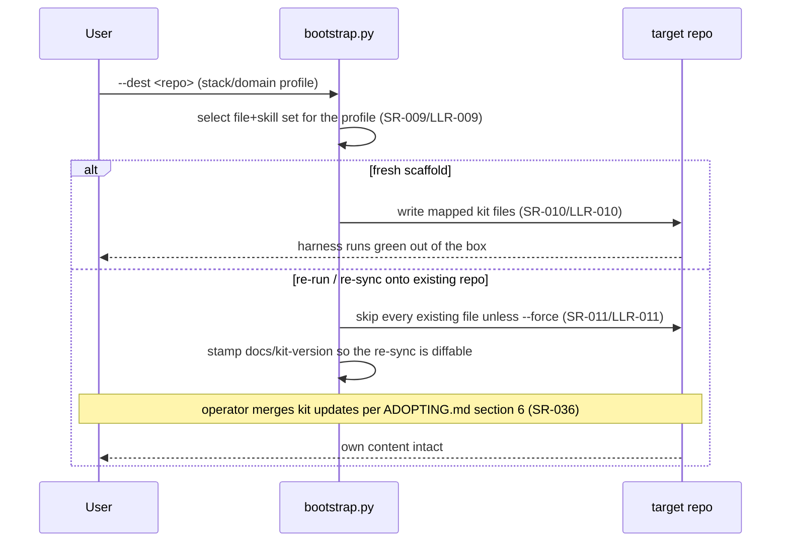
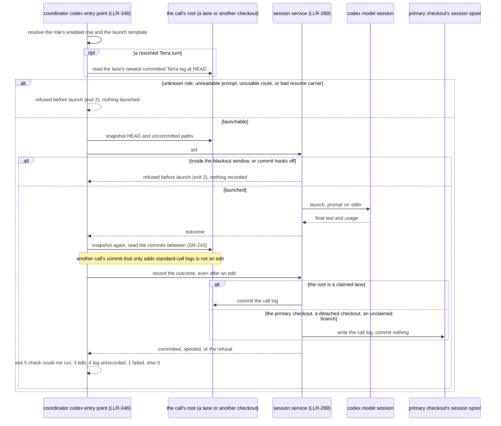
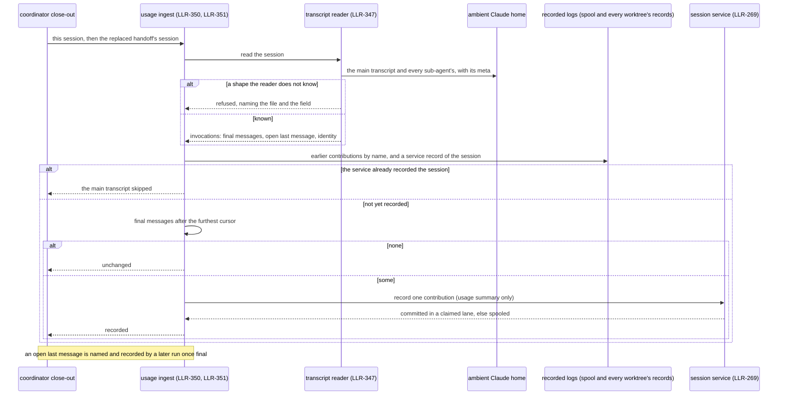

<!--
Contracts: IF-029 — the interface seam this document declares (process.md §8;
row of record in requirements/interfaces.toml).

Contract IF-029: the authored runtime-flow narrative, read as a checked
    structure. A heading named "Runtime flows" INSIDE the document opens the
    section (the document title does not count), the section holds at least one
    fenced mermaid diagram, and every diagram cites at least one SR or LLR id
    that exists in the registries. A cited `-000` placeholder id satisfies the
    citation rule and is never resolved, so a fresh scaffold starts green; the
    no-placeholders mode instead flags every such cite. Each heading owning a
    mermaid fence is one titled flow, which is the unit the dashboard embeds
    and the export summarizes.
-->

# Runtime flows — the kit meta-repo (self-adoption)

The kit's **authored architecture narrative**: the behaviors most easily
misread from registry rows — concurrency, what blocks on what, failure
handling — as hand-authored Mermaid sequence diagrams, each citing the SR/LLR
ids it renders (PROCESS.md §3, required at DevStg-Tests; `check_flows.py`
keeps the citations honest). This doc is the narrative half of the
architecture record: the **structural** half (module map, import graph,
declared `IF-###` seams, components) is *derived* from the registries and the
source tree and rendered in [`PROJECT_STATE.html`](../PROJECT_STATE.html)'s
"How (SW architecture)" tab, which also embeds these flows (owner ruling
2026-08-13u, sitting-2 decision 8 — the retired hand-authored architecture
doc is this doc's ancestor). The requirement spine it cites
lives in [`requirements/`](requirements/) + [`test/`](test/).

## Shape of the product

- **Checkers / generators** (`project-trajectory/scripts/*.py`) — stdlib-only,
  Python 3.11+, cross-platform (SR-034/SR-035). Each is invoked as a subprocess
  by the check harness (`check.py`) and by the test suite, so the "product" is a
  set of independently runnable commands, not a linked application.
- **Enforcement floor** (`project-trajectory/hooks/*`) — the pre-commit /
  pre-push / commit-msg hooks that run the integrity + secrets floor
  agent-neutrally (SR-019/SR-020).
- **Declared config** (`docs/stack.ini`, the generated `docs/stage`, and
  `docs/process.toml` — the one home for every process dial) — read once by the
  harness and the coordinator so a behavior is declared in text, not baked into
  a script (SR-007/SR-031).
- **The unattended station** (`agent_loop.py` + `dispatch.py` + `lane.py` +
  `integrate.py` + `handback.py` + `intake.py`, over `schedule.py`'s frontier)
  — the only subsystem here that is a *running* thing rather than a command:
  one dispatch loop per checkout drives N lanes from the WI frontier to trunk
  (SR-026/LLR-058/LLR-140). Flow 4 renders it; it is the piece most often
  misread from the rows alone.

## Runtime flows

> **The inherited drift this section used to record is RESOLVED (Flow 4).** Flow
> 4 renders the code as it stands after the concurrency-v2 program
> (WI-380/381/383/386/387/388). Three requirement rows it cited still described
> the model that program replaced — the composed-tree bar on a candidate
> worktree, and the five-class scheduling ladder — and LLR-143 still named the
> deleted `drive.py` as its Module. **The WI-451 re-tier closed all four**:
> those three rows were DEMOTED to the design tier, so the stale requirement
> text no longer exists to disagree with the diagram, and LLR-143 now names
> `dispatch.py`. What was owed to
> [WI-390](archive/work/complete/WI-390-concurrency-v2-program-close.md) as spine scope
> was discharged by the re-tier instead.
>
> **Every citation below was re-pointed onto the carrier that now holds the
> obligation**, which for the demoted rows is a design row. The old→new map is
> recorded in the campaign's log fragment rather than here, because naming a
> deleted id in this section is exactly what `check_flows` refuses — and it is
> right to: a flow must cite rows that exist.

### Flow 1 — Unattended coordinator session (SR-026, SR-027, SR-028, LLR-029)

```mermaid
sequenceDiagram
    participant Launcher as agent-resume launcher
    participant Loop as agent_loop.py (coordinator)
    participant Lock as dispatch lock — out/agent-loop.lock (LLR-029)
    participant Disp as dispatch.run — the station (Flow 4)
    participant Worker as agent_loop --wi (lane subprocess)
    participant Agent as agent CLI
    Launcher->>Loop: run --root .
    Loop->>Loop: preflight — commit hooks on? git repo? agent CLI? privacy author? (SR-240/LLR-340; SR-027/LLR-027)
    alt broken footing
        Loop-->>Launcher: typed nonzero exit (EXIT_PREFLIGHT), never hangs
    else ok
        Loop->>Lock: _coordinator_lock (SR-027/LLR-030 refuse a 2nd writer)
        Lock-->>Loop: held for the process lifetime (kernel-released on death — LLR-029)
        Loop->>Disp: _drive_entry — nothing is read from docs/status.md
        Note over Loop,Disp: resume authority is the claimed assignment plus the committed<br/>trailers on its branch (SR-026/LLR-026); the serial<br/>resume-from-status.md loop is retired
        Disp->>Worker: spawn per admitted lane, stdin closed (LLR-061)
        Note over Worker,Agent: the red cap is checked before the first session (SR-242/LLR-343),<br/>and a review is drawn only on a tip attested green (LLR-344)
        Worker->>Agent: run headless session(s)
        alt agent errors (retired model / auth)
            Agent-->>Worker: nonzero
            Worker->>Worker: log ERROR; all-ERROR region = unavailable agent (SR-028/LLR-028)
        else worked
            Agent-->>Worker: session output
        end
        Worker-->>Disp: typed worker exit — decided outcome or crash (Flow 4)
        Disp-->>Loop: first fatal code, or DONE once the station drains
        Loop-->>Launcher: typed outcome code (DONE/PAUSED/STALL/PREFLIGHT/…)
    end
```

### Flow 2 — Scaffold generation and re-sync (SR-009, SR-010, SR-011, SR-036)



### Flow 3 — Secrets + privacy floor at commit/push (SR-017, SR-018, SR-019, SR-020)

```mermaid
sequenceDiagram
    participant Dev as commit / push
    participant Hook as pre-commit / pre-push (SR-019/SR-020)
    participant Probe as kit-python.sh (LLR-021)
    participant Priv as check_privacy.py
    participant Policy as docs/process.toml
    Dev->>Hook: staged diff / outgoing range
    Hook->>Probe: interpreter, kit scripts directory, policy answer
    Probe->>Priv: ask for the one policy answer
    Priv->>Policy: one parse of the declared policy (SR-031/LLR-021, LLR-031)
    Priv-->>Probe: one closed answer
    alt scripts directory unavailable, mixed or unreadable declaration, or a failed or foreign answer
        Probe-->>Hook: refusal named
        Hook-->>Dev: REFUSE; name the cause and the repair (SR-019/SR-020/SR-031)
    else an exact answer
    Hook->>Priv: scan (always-on secrets floor, SR-017/LLR-017)
    Priv->>Policy: read declared toggle (SR-031/LLR-031 shared parse)
    alt privacy_check true
        Priv->>Priv: add PII/identity classes, honor EXEMPT_EMAILS (SR-018/LLR-018)
    end
    alt secret or (gated) identity found
        Priv-->>Hook: findings
        Hook-->>Dev: BLOCK before it publishes
    else clean
        Hook-->>Dev: allow
    end
    end
```

### Flow 4 — Station cycle: admission, lane, refresh, merge slot, intake (LLR-058, LLR-059, LLR-123, LLR-138, LLR-140)

One tick of `dispatch.run`. The three properties hardest to read off the rows:
the **spine barrier** is a property of admission (nothing slips past an
exclusive kind into a free lane), the **bar is attested to a tree** on the
branch *before* the merge slot rather than run on a composed tree inside it,
and **every lane ends in a merge** — a worker that cannot finish hands back and
the run keeps going.

```mermaid
sequenceDiagram
    participant Sched as schedule.py frontier (LLR-058/LLR-123, LLR-152)
    participant Disp as dispatch.py tick loop (LLR-149)
    participant Lane as lane.py worktree + subprocesses (LLR-150)
    participant Hand as handback.py (LLR-144)
    participant Slot as integrate.py merge slot (LLR-140/LLR-151)
    participant Intake as intake.py (LLR-153/LLR-154)
    loop each tick, until a fatal code or a drained queue
        Disp->>Disp: tracked pause? dirty trunk? (LLR-138) — freeze admission, let lanes come home
        Disp->>Disp: blackout window open? (LLR-300) — claim nothing; an idle station waits it out
        Disp->>Sched: re-derive the ready frontier as (WI, kind) pairs
        Sched-->>Disp: exclusive kinds ranked ahead of parallel ones (LLR-059/LLR-123)
        alt an exclusive kind is on the frontier
            Note over Disp: THE SPINE BARRIER — admission stops outright;<br/>the batch admits alone, sole toucher of trunk
        else free lane and parallel work
            Disp->>Slot: claim, dispatch lock held (LLR-140/LLR-151)
            Note over Disp,Slot: inactive commit hooks refuse before the coordinator guard<br/>and dispatch lock (SR-240/LLR-340)
            Slot-->>Disp: spec to active/&lt;branch&gt;/ on a trunk commit, branch cut from it
            Disp->>Lane: spawn the worker subprocess on the lane worktree
        end
        Lane-->>Disp: worker exit
        alt decided non-DONE exit (NEEDS-HUMAN, blocked, budget, stall, red cap)
            Disp->>Hand: close_partial — commit as-is, spec to terminal partial/ with a per-close report
            Note over Disp,Hand: the lane still closes into trunk and the run<br/>continues; only a FAILED handback stops it (LLR-144)
        else crash (traceback, signal)
            Note over Disp: claim stays in active/&lt;branch&gt;/; the next tick<br/>resumes it, bounded by the stall guard
        end
        Disp->>Lane: spawn the refresh — mechanical, no agent
        Lane->>Lane: merge trunk in, then trunk_step, then the check.py bar
        Lane->>Lane: commit a Bar-Green trailer naming the landing bar (or no-bar), the tree it barred and its work parent
        alt refresh red
            Note over Disp,Hand: a branch asserting DONE stops the run; one that merges<br/>nothing is quarantined once (code reverted, diff kept<br/>as a bar-inert patch) and refreshed again
        else refresh green
            Disp->>Slot: merge this lane's branch only — the slot is sub-second
            Slot->>Slot: is trunk already an ancestor, and does the tip attest its OWN tree for the landing bar?
            Slot->>Slot: merge --no-ff, ff trunk, unload, audit
            Slot->>Intake: post-merge arm, still inside the held slot (LLR-154)
            Intake-->>Slot: rows the merge forces, as ONE bookkeeping commit on trunk (LLR-153)
        end
    end
    Disp->>Intake: empty frontier — gap census mints gap-closure rows, else drain and exit 0
```

### Flow 5 — The blackout window on both routes (SR-227, SR-229, SR-230, LLR-270, LLR-300, LLR-301)

One window function answers "inside a window?" and "when did the last one
end?"; every reader below asks it at the call. A lane claimed before the window
stays claimed and idle, and resumes after it.

```mermaid
sequenceDiagram
    participant Win as blackout window function (agent_policy)
    participant Claim as integrate.claim (LLR-300)
    participant Svc as session service launch boundary
    participant Loop as agent_loop / dispatcher
    participant Hook as coordinator guard hooks (LLR-300/LLR-301)
    participant Keep as retained adjudicator keep (LLR-270)
    Claim->>Win: inside? (every route, the dispatcher's included)
    Win-->>Claim: inside: refused, naming the UTC end
    Loop->>Svc: launch a session (build, review, probe, interactive)
    Svc->>Win: inside?
    alt inside, and not an ADJUDICATE call for an active claim
        Svc-->>Loop: BlackoutRefused, nothing launched or recorded
        Loop->>Loop: wait the window out (banner + countdown), retry
    else the wrap-up adjudication of an active claim, or outside
        Svc->>Keep: plan the retained session
        Keep->>Win: when did the last window end?
        Keep-->>Svc: last used before that end: retired (blackout), mint
    end
    Hook->>Win: inside? (at any context_guard_pct)
    alt inside
        Hook-->>Hook: deny Agent, SendMessage, a model CLI; tell the close-down
        Note over Hook: no relaunch requested; a pending one is cancelled at SessionEnd
    end
    Keep->>Win: keep-warm tick: inside? (no ping), else retire a stale session first
```

### Flow 6 — The coordinator's judging turn and act turn (SR-231, SR-232, SR-209, SR-178, LLR-306, LLR-338, LLR-359)

A judging turn reserves and binds a verdict, recording the identity of each
judged row's approved text beside it, launches its judging brief, commits and
accepts the verdict, then stops. After the lane has rebased, a later act turn
derives only the remaining authorized work from that committed verdict. For a
held CLARITY row the act turn checks that the committed row's approved text
still has the bound identity, and refuses before launch when it does not; for
the other judged rows the coordinator confirms by hand that they are
unchanged.

```mermaid
sequenceDiagram
    participant Coord as coordinator adjudication entry
    participant Lane as claimed clean lane
    participant Verdict as committed verdict and binding
    participant Keep as retained adjudicator plan
    participant Agent as adjudicator session
    participant Records as approved-row records
    Coord->>Lane: confirm the judging lane claim (SR-231)
    Coord->>Verdict: reserve path and bind the judging brief and its judged rows' identities (LLR-306, LLR-359)
    Coord->>Agent: launch judging brief
    Agent->>Verdict: commit verdict
    Coord->>Verdict: validate and record accepted verdict
    Note over Coord,Verdict: The judging turn stops here.
    Coord->>Lane: confirm lane claim and no uncommitted change (SR-231/LLR-306)
    Coord->>Verdict: read accepted verdict and binding at HEAD (LLR-338)
    alt verdict is unaccepted, owes no act, has an unexplained row state, or binds a held CLARITY row to other text than its committed approved text (LLR-359)
        Coord-->>Lane: refuse before launch, naming the input
    else later act is owed
        Coord->>Keep: plan by the verdict's bound class (LLR-338)
        Coord->>Agent: launch complete act brief; append loop provenance when marked (SR-209)
        Agent->>Records: take amendment act, then first-approval act
        Coord->>Verdict: re-derive owed work and inspect verdict-record changes
        alt call succeeded, nothing owed, and verdict records unchanged
            Coord-->>Lane: complete
        else work remains or verdict records changed
            Coord-->>Lane: fail after launch, naming the remaining condition
        end
    end
```

### Flow 7 — A coordinator codex call (SR-243, SR-222, LLR-346, LLR-269)

A Sol review or critique, or a Terra turn, starts from the coordinator's entry
point and goes through the one session service. The change check sits between
the call and its record, because the record's own commit moves the lane's HEAD;
where the log goes is read from the root, never chosen by the caller.



### Flow 8 — A usage ingest at close-out (SR-244, SR-222, LLR-347, LLR-350, LLR-351, LLR-269)

A Claude coordinator's own session and the sub-agents it spawned make model
calls the kit never launched. At close-out (and at a headless leg's end) the
coordinator runs the usage ingest for its own session, then again for the
session the replaced handoff names, so that session's tail is recorded too.
The reader is the only code that knows Claude Code's transcript format; the
records go through the one session service, so where a log lands is read from
the root, never chosen by the command.


